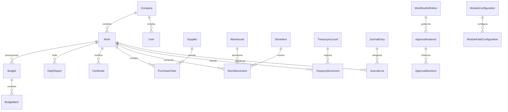

# LITORAL NEA ERP — FASE 2: Ingeniería de datos y contratos API

**Revisión inicial: 16/10/2026** · Rama `feature/phase2-data-readiness-api-20261016` · Estado: preparado para QA, **no desplegado ni migrado**.

## Alcance técnico constatado

- El esquema `database/prisma/schema.prisma` contiene **82 modelos Prisma** y existen **10 directorios de migraciones**.
- La navegación de `frontend/lib/modules.ts` contiene **45 módulos**.
- Hay **41 definiciones de campos registrables** y **4 módulos de lectura/workflow/administración** definidos separadamente.
- Existe CRUD parametrizado mediante `/records/:module`, además de servicios de dominio y controladores especializados. La existencia de rutas y modelos **no prueba integridad operativa** de punta a punta.
- El seed histórico tenía sólo **34** módulos en la lista usada para generar permisos. La rama cambia esa generación para recorrer los **45 módulos actuales** sin ejecutar `prisma db seed` ni modificar usuarios o roles existentes.

## Estado real de infraestructura — lectura de Render

| Recurso | Observación comprobada | Decisión |
| --- | --- | --- |
| PostgreSQL original `litoral-nea-erp-db-viu198x` | Plan gratuito, suspendida desde 06/10/2026 por facturación/vencimiento | No intentar migrar ni utilizar como fuente hasta verificar su conservación |
| PostgreSQL nueva `litoral-nea-erp-db-free-202610` | Disponible, PostgreSQL 16, creada 15/10/2026; expira 14/11/2026 | Verificar esquema, contenido y copia de seguridad desde red autorizada |
| Acceso de consulta Render externo | IP allowlist vacía: herramienta de SQL no puede conectarse | **No modificar allowlist** ni publicar acceso externo |
| API `litoral-nea-erp-api-viu198x` | Último deploy activo observado corresponde al commit 7e7305f8 del 24/09/2026 | Confirmar `DATABASE_URL` activa en Render sin revelar contraseña |
| Sitio `litoral-nea-erp-web-viu198x` | Último deploy activo observado del mismo commit | No confundir GitHub main con código servido actualmente |

**Sin conexión de lectura a la nueva BD:** no se puede afirmar que contenga los registros antiguos, que sus migraciones estén aplicadas ni que el backend la esté utilizando. Un cambio de `DATABASE_URL` antes de verificar esto puede dejar inaccesibles o separar los datos existentes.

## Matriz de los 45 módulos: rutas de persistencia y fuentes de datos

La columna «Fuente/modelo» representa fuentes relevantes existentes, **no** un ERD completo ni garantía de que todas las operaciones sean transaccionales.

| # | Slug | Módulo | Implementación observada | Fuente/modelo relevante |
|---:|---|---|---|---|
| 1 | dashboard | Dashboard general | Especial lectura | Work, Certificate, CashBox, BankAccount, TaxEstimate |
| 2 | works | Obras | Obras específica | Work, WorkMember, Organization |
| 3 | technical-workspace | Mi trabajo técnico | GenericRecord / mixto (7) | GenericRecord; TechnicalTask / Workspace API |
| 4 | notifications | Notificaciones | GenericRecord / mixto (7) | GenericRecord; Notification / Workspace API |
| 5 | architecture | Arquitectura | GenericRecord / mixto (7) | GenericRecord |
| 6 | engineering | Ingeniería | GenericRecord / mixto (7) | GenericRecord |
| 7 | documents | Documentación | Documentación específica | Document, DocumentVersion |
| 8 | budgets | Presupuestos | Dominio de obra (9) | Budget, BudgetItem |
| 9 | planning | Planificación | GenericRecord / mixto (7) | GenericRecord |
| 10 | progress | Avances | Dominio de obra (9) | DailyReport |
| 11 | public-works | Obra pública | GenericRecord / mixto (7) | GenericRecord; Work, Dossier |
| 12 | certificates | Certificados | Dominio de obra (9) | Certificate |
| 13 | dossiers | Expedientes | Dominio de obra (9) | Dossier, DossierMovement |
| 14 | purchases | Compras | Dominio económico (8) | PurchaseOrder, Supplier |
| 15 | suppliers | Proveedores | Dominio económico (8) | Supplier, Organization |
| 16 | logistics | Logística | GenericRecord / mixto (7) | GenericRecord; Warehouse, StockMovement |
| 17 | stock | Depósitos y stock | Dominio económico (8) | StockItem, StockMovement, Warehouse |
| 18 | treasury | Tesorería | Tesorería específica | TreasuryAccount, TreasuryMovement, TreasuryCheque, TreasuryReconciliation |
| 19 | cash | Cajas | Dominio económico (8) | CashBox, FinancialMovement |
| 20 | banks | Bancos | Dominio económico (8) | BankAccount, FinancialMovement |
| 21 | payments | Pagos y cobros | Dominio económico (8) | FinancialMovement |
| 22 | accounting | Contabilidad | Dominio económico (8) | JournalEntry, JournalLine, ChartAccount |
| 23 | taxes | Impuestos | Dominio económico (8) | TaxEstimate |
| 24 | fleet | Flota | Dominio operativo (10) | Vehicle |
| 25 | drivers | Choferes | Dominio operativo (10) | Driver |
| 26 | fuel | Combustible | Dominio operativo (10) | FuelLog |
| 27 | machinery | Maquinarias | Dominio operativo (10) | Machine |
| 28 | concrete | Hormigonera | Dominio de obra (9) | ConcreteOrder |
| 29 | maintenance | Mantenimiento | Dominio operativo (10) | MaintenanceOrder, MaintenancePlan |
| 30 | mechanics | Mecánicos | Dominio operativo (10) | Mechanic |
| 31 | spare-parts | Repuestos | Dominio operativo (10) | SparePart, MaintenancePart |
| 32 | fuel-estimates | Estimación combustible | Dominio operativo (10) | FuelEstimate |
| 33 | insurance | Pólizas y cauciones | Dominio operativo (10) | InsuranceCompany, InsurancePolicy |
| 34 | unexpected-tasks | Trabajos imprevistos | Dominio operativo (10) | UnexpectedTask |
| 35 | hr | RR.HH. | Dominio de obra (9) | Employee |
| 36 | personnel-control | Control de personal | Dominio transversal (4) | AttendanceRecord, EmployeeWorkAssignment |
| 37 | safety | Seguridad e Higiene | Dominio transversal (4) | SafetyCredential, PPEIssue, SafetyTraining, SafetyIncident, SafetyInspection |
| 38 | assets | Inventario de activos | Dominio transversal (4) | GeneralAsset |
| 39 | stakeholders | Terceros y dependencias | Dominio transversal (4) | OrganizationStakeholderRole, Organization |
| 40 | payroll | Sueldos | Dominio de obra (9) | Payroll |
| 41 | per-diems | Viáticos | Dominio de obra (9) | PerDiem |
| 42 | lodging | Alojamientos | Dominio de obra (9) | Lodging |
| 43 | management | Gerencia | Especial lectura | Work, Certificate, CashBox, BankAccount, TaxEstimate |
| 44 | approvals | Aprobaciones | Workflow específico | WorkflowDefinition, ApprovalInstance, ApprovalDecision |
| 45 | system | Sistema | Administración específica | ModuleConfiguration, ModuleFieldConfiguration, RolePermission, AuditLog |

## Relaciones relevantes a formalizar en ERD

Este diagrama enumera relaciones observadas en Prisma; no incluye aún todos los atributos y cardinalidades de los 82 modelos.

## API implementada en esta rama: diagnóstico protegido

- **GET `/api/v1/system/data-readiness`**: autenticado, permiso obligatorio `system.admin`.
- Consulta únicamente lectura del historial Prisma `_prisma_migrations` y del catálogo `ModuleConfiguration` / `ModuleFieldConfiguration`.
- Informa migraciones esperadas/aplicadas/faltantes/incompletas, módulos configurados/activos, ausencia de campos registrables y estado `READY_FOR_REVIEW` o `ACTION_REQUIRED`.
- Ante fallo de conexión o ausencia de tabla: HTTP 503, sin cadenas de conexión, tokens ni registros personales.
- El estado `READY_FOR_REVIEW` **NO** significa «apto para producción»: no acredita backups, integridad de stock/tesorería, pruebas E2E ni permisos por obra.
- UI: panel de ejecución manual en **Sistema**; sin consultas de fondo ni operaciones de escritura.
- **No se aplica migración en esta fase**. Debe probarse primero contra una copia/entorno aislado.

## Hallazgos de diseño prioritarios

1. **P0 — Continuidad de datos:** comprobar si la base nueva tiene el dataset real y si el backend apunta a ella; exportar respaldos de origen/destino y practicar restauración antes de migrar.
2. **P0 — Aislamiento lógico:** algunos registros sin obra —ejemplo `GenericRecord.workId = null`— no tienen `companyId` directo; al admitir otra razón social habría riesgo de lectura cruzada. El alcance actual de una sola empresa no elimina la deuda técnica.
3. **P0 — Trazabilidad económica:** compras→recepción→stock→costo obra→proveedor→pago; certificación→factura→cobro; asistencia→sueldos→pagos. Requiere transacciones, idempotencia y pruebas reales.
4. **P1 — Especificidad de modelo:** siete módulos mantienen `GenericRecord` o rutas mixtas, sin entidad específica completa. Priorizar planificación, obra pública y logística por su impacto en costos y cronogramas.
5. **P1 — Validaciones SQL:** revisar unicidad por ámbito, fechas de valor, `Decimal`, estados, baja lógica, índices, ciclos de aprobación y cierres; no aplicar DDL antes de respaldo y validación del estado.
6. **P1 — Configuración dinámica:** probar re-seed reversible de los 45 permisos en una copia; **no correr seed demo en producción**, porque contiene datos ficticios y puede modificar asignaciones.

## Contratos API a desarrollar después del diagnóstico

- **Maestros:** obras, clientes/organismos, proveedores, personas, activos, catálogos e identificadores estables.
- **Obra:** EDT, presupuestos versionados, APU, partes/mediciones, certificados, adicionales, expedientes, recepciones.
- **Abastecimiento:** requisición, cotizaciones, OC, remito, factura, reservas, Kardex de stock.
- **Finanzas:** cuentas, pagos/cobros, imputaciones, partidas contables, cheques, cierres y conciliaciones.
- **RRHH:** legajos, fichadas, novedades, sueldos, cargas y viáticos.
- **Soporte:** auditoría, historial, estado de workflow, notificaciones, documentos versionados.

Para cada ruta futura definir DTO con `class-validator`, permiso y ámbito, idempotencia, transacciones, respuesta tipada, código de error, paginación y pruebas negativas. **No presentar estas rutas como implementadas**.

## Secuencia de liberación segura

1. Confirmar `DATABASE_URL` configurada en Render desde su panel, sin copiar ni publicar secretos.
2. Confirmar migraciones reales vía endpoint autenticado o consulta interna autorizada; si el servicio no arranca, ejecutar SQL de sólo lectura desde red interna.
3. Respaldar y restaurar copia verificable de PostgreSQL; validar conteos, integridad y hashes de documentos.
4. Ensayar migraciones y seeds sobre clon; registrar resultados, precondiciones y rollback.
5. Integrar código tras CI, CodeQL y autorización del administrador.
6. Validar permisos y ciclos end-to-end; desplegar con ventana controlada y monitoreo, nunca sobre BD sin respaldo.

## Código y comprobaciones

- `backend/src/system/data-readiness.service.ts`
- `backend/src/system/data-readiness.controller.ts`
- `backend/src/system/system.module.ts`
- `frontend/components/data-readiness-panel.tsx`
- `frontend/components/erp-app.tsx`
- `backend/test/data-readiness.test.mjs`
- `database/prisma/seed.ts` (corrección del universo de permisos a los 45 slugs)

**Control de cambios:** revisión por Pull Request separado, sin actualización de `main`, migraciones ni hosting en esta intervención.
